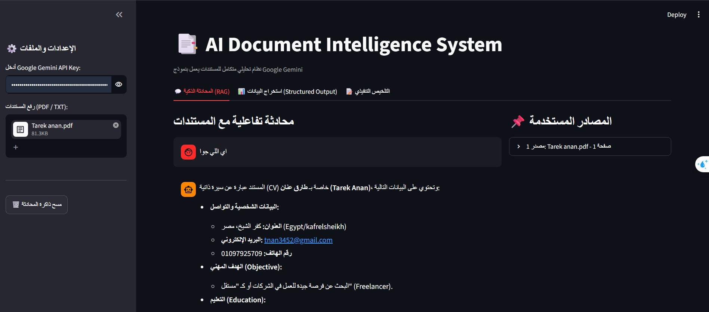
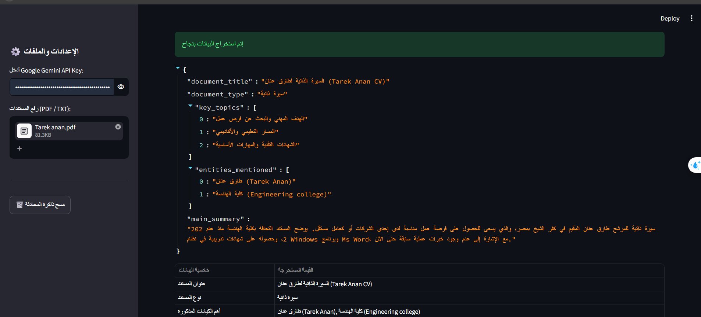

# 🚀 [Tips Hindawi](https://www.tipshindawi.com/) Internship (August–October) 2026

> 🎓 This project was built during the [ **Tips Hindawi** ](https://www.tipshindawi.com/) **Internship (August–October) 2026**.

## 👤 Participant

| Field            | Value                                |
| ---------------- | ------------------------------------ |
| Full Name        |    Tarek Abdulrahman Anan                                  |
| Project Name     |   AI Document Intelligence System                                  |
| GitHub Username  |      tarekanan12                                |
| Internship Batch | August–October 2026                  |
| Training Program | Large Language Models (LLMs) Program |
| Organization     | [**Edrak for Ai**](https://edrak4ai.com/en)                         |

---

# 📖 Project Overview

**AI Document Intelligence System** is a comprehensive document analytical tool and intelligent processor that allows users to upload **PDF** and **TXT** files, interact with them using **RAG (Retrieval-Augmented Generation)** techniques, and extract detailed structured data using the **Google Gemini** model.
---

# ✨ Features

1* **💬 Interactive Document Chat (RAG Chat):** Ask questions and receive precise, context-aware answers complete with source citations and page numbers directly from uploaded documents.
2* **📊 Structured Data Extraction:** Convert unstructured text into reliable, structured JSON data and formatted tables using Pydantic Output Parsers.
3* **📝 Executive Summarization:** Generate comprehensive summaries including key takeaways, required decisions or recommendations, and overall document tone.
4* **⚡ Fast Semantic Search:** Built-in vector search powered by `Chroma DB` and Hugging Face embeddings for efficient document indexing and retrieval.
5* **🎨 Interactive User Interface:** Simple, responsive, and user-friendly interface powered by `Streamlit`.

---

# 🛠️ Technologies Used

* **Language:** Python 3.10+
* **Framework:** LangChain (`langchain-core`, `langchain-community`, `langchain-google-genai`, `langchain-huggingface`)
* **LLM Model:** Google Gemini (`gemini-1.5-flash`)
* **UI Framework:** Streamlit
* **Vector Database:** Chroma DB
* **Embeddings:** Hugging Face (`all-MiniLM-L6-v2`)
* **Data Parsing & Modeling:** Pydantic Output Parser & Pandas

---
---

# ⚙️ Installation

1. **Clone the repository:**
   ```bash
   git clone [https://github.com/your-username/AI-Document-Intelligence-System.git](https://github.com/your-username/AI-Document-Intelligence-System.git)
   cd AI-Document-Intelligence-System

   2. Create and activate a virtual environment:
   Windows:
   python -m venv venv
venv\Scripts\activate

Linux/macOS:
python -m venv venv
source venv/bin/activate

3. Install the required dependencies:
pip install --upgrade streamlit langchain langchain-core langchain-community langchain-google-genai langchain-huggingface chromadb pydantic pandas pypdf

---

# 🚀 Usage

1. Run the Streamlit application using the command:
streamlit run app.py

2. Obtain a Google Gemini API Key (free) from Google AI Studio.

3. Enter your API Key in the application sidebar.

4. Upload your documents in PDF or TXT format.

5. Switch between tabs to chat with your files, extract structured JSON metadata, or generate executive summaries.

---

# 📸 Demo


### 💬 Interactive RAG Chat & Sources


### 📊 Structured Output (JSON & Tables)


---

# 📈 Results

Developed a robust local RAG pipeline with accurate context retrieval and page-level source tracking.

Successfully implemented structured output parsing, turning unstructured PDF data into schema-validated JSON with minimal hallucination.

Delivered high-performance document summarization suitable for executive decision-making.

---

# 🔮 Future Improvements

1. Add support for additional document types such as Microsoft Word (.docx) and Excel (.xlsx).

2. Implement persistent session and chat history storage using relational or NoSQL databases.

3. Integrate fully local LLM backends such as Llama 3 via Ollama.

---

# 📚 About the Internship

This project was developed as part of the [**Tips Hindawi**](https://www.tipshindawi.com/) **Internship (August–October) 2026**, and it will be showcased on the official [Tips Hindawi](https://www.tipshindawi.com/) website.

[Tips Hindawi](https://www.tipshindawi.com/) is the internships department of [**Edrak for Ai**](https://edrak4ai.com/en), and the internship encourages participants to build real-world projects, apply practical skills, and showcase their work through GitHub.

For more information about the internship, training programs, and upcoming batches, visit the official [Tips Hindawi](https://www.tipshindawi.com/) website.

---

# 📄 License

This project is shared for educational and portfolio purposes.
